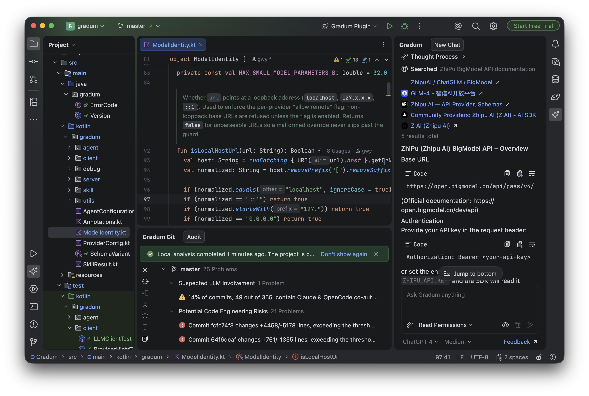

<h2 align="center">Gradum</h2>

<p align="center">
  
  
  
  
</p>

<p align="center">
  <b>Gradum Runtime</b> is a local runtime for extensible AI agents. It runs on your own machine and gives every
  connected client the same core: a model of your choice (local Ollama or LM Studio, or your own API key to
  Zhipu BigModel, DeepSeek, MiniMax, or any OpenAI-compatible endpoint); hot-swappable skills that read and
  edit files, explore project structure, and run shell commands; and a safety layer that intercepts destructive
  actions before they execute. Coding is the skill set it ships with, not the shape it is locked to.
</p>

<p align="center">
  Your code, conversations, and API keys never leave your machine. Connect through the IntelliJ IDEA plugin,
  the built-in browser skill editor, or any ACP-capable IDE client. Written in Kotlin, the runtime also serves
  as the base for building your own agents and tools.
</p>

## Screenshots

<div align="center">
  
  
</div>

## What the Runtime Provides

- **Multimodel support**: works out of the box with local Ollama, LM Studio, vLLM, and LocalAI, plus Zhipu
  BigModel, DeepSeek, MiniMax, and any OpenAI-compatible endpoint; switch models without changing code
- **Skill system**: every capability ships as a hot-swappable skill: built-in coding skills, MCP tools, and
  external skill directories; replace, extend, or add skills without restarting
- **Command safety filter**: every shell command is classified before it runs (blocked, needs approval, or
  allowed); destructive operations require your approval, and privilege escalations are blocked outright;
  the lists are overridable in `settings.json`
- **Session continuity**: conversation history survives restarts and picks up where you left off; each record
  is verified on load, and corrupted or tampered entries are discarded before they reach the model's context
- **Streaming events**: an NDJSON event stream delivers thinking, tool calls, and answers to clients in
  real time
- **ACP support**: implements the Agent Client Protocol over stdio, with permission requests bridged to the
  client; any ACP-capable IDE connects directly
- **HTTP API**: local endpoints that give the plugin and other local integrations a single interface
- **Sequential editing**: search-replace edits are applied one by one, with each result reported
- **Background processes**: GUIs and long-running servers can detach without blocking the session
- **Skill editor**: a bundled browser-based Kotlin IDE at `GET /skills/editor`, with syntax highlighting, a
  problems panel, and a minimap; Run deploys the source to `~/.gradum/skills`, where the hot-reload watcher
  picks it up

## Getting Started

Download the archive for your platform from the
[Releases](https://github.com/lg841226/Gradum/releases/latest) page. Each release is self-contained and
includes its own runtime; no Java installation is required.

- `gradum-darwin-arm64.zip` and `gradum-darwin-x64.zip` (macOS; double-clicking opens a terminal window that
  streams the server logs)
- `gradum-linux-x64.zip` and `gradum-linux-arm64.zip`
- `gradum-windows-x64.zip` (runs in a console window with UTF-8 stdio)

Run the configuration wizard once:

```bash
java -jar gradum@1.0.2.jar setup    # first run: pick provider, key, base URL
```

The wizard writes your choices to `~/.gradum/settings.json` (and generates `settings.schema.json` for editor
autocompletion). Starting the server, opening the editor, and connecting an IDE all read this file. The old
`--host`, `--port`, and `--api-key` flags have been removed.

The runtime offers three entry points:

| Command  | What it does                                                         |
|----------|----------------------------------------------------------------------|
| *(none)* | Start the HTTP server (NDJSON `/events` streaming API)               |
| `setup`  | Interactive provider configuration wizard (full-screen terminal TUI) |
| `acp`    | ACP stdio server for IDE agent clients                               |

```bash
java -jar gradum@1.0.2.jar --help   # usage, configuration overview, endpoint list
java -jar gradum@1.0.2.jar acp      # Agent Client Protocol over stdin/stdout
```

Once the server is running, open `GET /skills/editor` in a browser to use the skill editor.

### Install the IntelliJ IDEA Plugin

The plugin ships without prebuilt archives and is built from source (JDK 25 required):

```bash
./gradlew :plugin:buildPlugin
```

Install `plugin/build/distributions/gradum-*.zip` via `Settings > Plugins > Install Plugin from Disk`, then
point the plugin at a running Gradum Runtime.

### ACP Clients

`gradum acp` implements the Agent Client Protocol over stdin/stdout. The ACP agent card lives at
[`registry/gradum/agent.json`](registry/gradum/agent.json) (version, per-platform download digests,
`args: ["acp"]`), so registry-aware clients can install and launch Gradum directly. When no provider is
configured yet, the initialize response advertises a `terminal` auth method that runs `gradum setup` in your
terminal.

## Settings File

`~/.gradum/settings.json` is the single source of truth, with a JSON Schema alongside for editor
autocompletion:

```jsonc
{
  "server": {
    "host": "localhost",
    "allowRemote": false,
    "port": 8765,
    "autoDetectPort": false,
    "apiKeyFile": null
  },
  "llm": {
    "baseUrl": "http://localhost:11434",
    "model": "",
    "think": false
  },
  "commandFilter": {
    "blockedExecutables": ["reboot", "shutdown", "..."],
    "protectedPaths": { "...": "..." }
  },
  "mcpServers": [
    { "name": "idea", "command": "...", "workingDir": "...", "env": {} }
  ],
  "plugins": {},
  "ollama.baseUrl": "http://localhost:11434",
  "ollama.apiKey": "",
  "zhipu.apiKey": "",
  "deepseek.apiKey": "",
  "minimax.apiKey": "",
  "lmstudio.baseUrl": ""
}
```

Unknown keys are reported at startup rather than silently ignored, and the whole file is validated as a
compact issue tree (`Invalid gradum.settings (fix ~/.gradum/settings.json)`). To reach the editor from other
devices on your LAN, set both `"host": "0.0.0.0"` and `"allowRemote": true`; a non-loopback host without that
opt-in refuses to start, and every request still carries a per-machine bearer token. Server logs go to stdout
and to rotating files under `~/.gradum/logs/` (the ACP transport additionally writes `~/.gradum/logs/acp.log`).

## LLM Backend Setup

The `search_web` skill uses the [Tavily Search API](https://tavily.com); set `TAVILY_API_KEY` to enable it (the free
tier includes 1,000 calls per month). Every other skill works without a key.

Provider base URLs and API keys live in `~/.gradum/settings.json`; the recommended way to write them is
`java -jar gradum@1.0.2.jar setup` or the plugin's settings page. Environment variables work as a fallback
for cloud keys:

```bash
export ZHIPU_API_KEY="your-key-here"       # Zhipu BigModel (GLM)
export DEEPSEEK_API_KEY="your-key-here"    # DeepSeek
export MiniMax_API_KEY="your-key-here"     # MiniMax (exact spelling)
export TAVILY_API_KEY="your-key-here"      # web search skill
```

Local providers (Ollama, LM Studio) need no key; their base URLs are read from `ollama.baseUrl` and
`lmstudio.baseUrl`.

## IntelliJ IDEA Plugin

The IDEA plugin brings Gradum Runtime into the workspace you already use. Hand it a task: it reads the files
the task involves, presents edits for your review before they land, and asks before running any command.

- **Rooted on your machine**: connect to local Ollama or LM Studio, or to your own cloud model service; data stays on
  your machine and never routes through a third party
- **Skills as code**: the agent's tools are Kotlin skills; modify them in the bundled browser editor and the
  changes apply on the next conversation turn
- **Command safety**: every shell command is classified before it runs; destructive operations require your
  approval, and privilege escalations are blocked outright
- **Session recovery**: conversation history survives restarts; records are verified on load, and corrupted
  or tampered entries never reach the model's context
- **Statistical Git risk analysis**: a bottom tool window reviews your local commit history, presents risk
  findings by theme and severity, and computes a project quality band

Other capabilities include streaming responses, thinking previews, tool call indicators, rich Markdown
rendering, dark and light themes, file and image attachments, and one-click sending of the file you are
editing. The plugin is built with Kotlin and Jewel, runs entirely locally, and is at version 1.0.3.

## Security

The command safety filter classifies shell commands before anything runs:

- **Blocked**: destructive system tools (`mkfs*`, `mkswap`, `fdisk`, `sfdisk`, `parted`, `gdisk`, `shutdown`,
  `reboot`, `poweroff`)
- **Needs approval**: risky but legitimate commands (`dd`, destructive `rm`, permission changes, and
  similar); the agent asks before executing
- Privilege escalators (`sudo`, `su`, `doas`, `pkexec`) are recognized structurally, so the filter sees
  through such wrappers
- Protected paths (`/etc`, `/usr`, `~/.ssh`, and similar) are guarded separately; `/tmp` is always allowed

Blocked executables and protected paths are overridable through the `commandFilter` section of
`settings.json`.

The local HTTP API itself is guarded in depth: a `Host` whitelist rejects DNS-rebinding attempts, every
route except `/health` requires the bearer token stored in `~/.gradum/server.token` (0600; the plugin reads
the same file), the skill editor exchanges a `?token=` for an `HttpOnly` cookie, and the server refuses to
start when `server.host` is not a loopback address.

## Building from Source

The server requires JDK 21 and the IntelliJ plugin requires JDK 25; the repo pins no JDK path, and Gradle
uses the JDK from your `JAVA_HOME` or the Gradle JVM selected in your IDE:

```bash
./gradlew buildFatJar            # cross-platform fat jar, output to build/libs/
./gradlew :plugin:buildPlugin    # IDEA plugin zip, output to plugin/build/distributions/
```

The build is not a single-JDK, single-command affair (the dual-JDK requirement, the IDE-copied jars, and
fat-jar packaging each have known limitations). If a build fails, consult the full checklist in
[CONTRIBUTING.md](CONTRIBUTING.md) first.

## Documentation Help

- [Architecture](docs/ARCHITECTURE.md): system design, data flow, modules, ACP transport, packaging
- [Plugin Features](docs/PLUGIN_FEATURES.md): detailed feature index: chat, Markdown pipeline, git analysis,
  i18n, icons
- [Coding Standards](docs/CODING_STANDARDS_KOTLIN.md): Kotlin conventions
- [Skill Development](docs/PLUGIN_DEVELOPMENT.md): creating custom skills
- [Infrastructure Pitfalls](docs/INFRASTRUCTURE_PITFALLS_EN.md): Jewel, Compose, and Classloader integration
  limitations
- [Logging Guide](docs/LOGGING_GUIDE.md): logger naming and levels
- [Versioning](docs/VERSIONING.md): bump rules and release naming
- [Changelog](CHANGELOG.md) · [Privacy Policy](PRIVACY.md) · [Contributing](CONTRIBUTING.md)

## Contributing

1. Fork the repository
2. Create a feature branch: `feature/@your-name-add-thing`
3. Commit with descriptive messages
4. Open a pull request

## License

MIT License, see [LICENSE](LICENSE)

## Gradum Version

Server 1.0.2, Plugin 1.0.4
